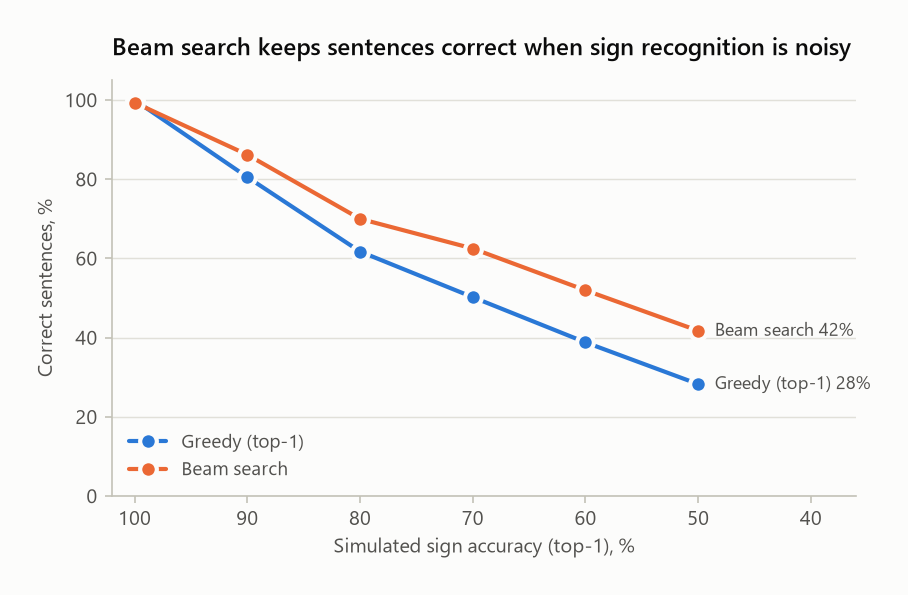

# Greedy vs beam-search decoding under simulated recognition noise

Each of the 46 default-vocabulary test sentences was signed 20 times per noise level. A wrong sign is drawn from the uniform (no trained model yet); in 25% of the errors the right sign is not even among the top-3 candidates. Sentences are compared after the rule engine.

| Simulated sign accuracy | Greedy (top-1) | Beam search |
|---|---|---|
| 100% | 100.0% | 99.3% |
| 90% | 80.5% | 86.2% |
| 80% | 61.7% | 70.0% |
| 70% | 50.2% | 62.5% |
| 60% | 38.8% | 52.0% |
| 50% | 28.3% | 41.7% |

